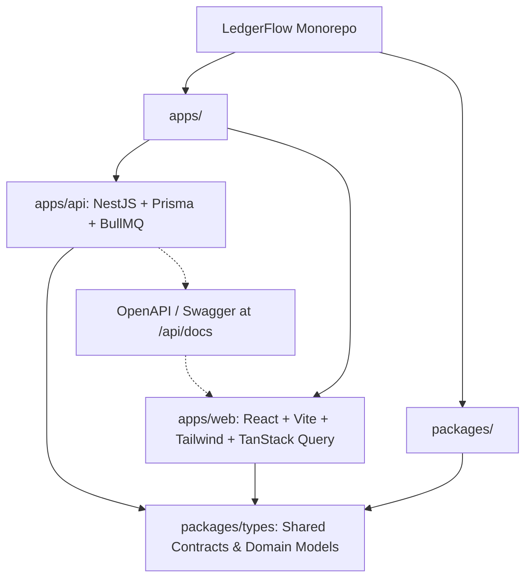
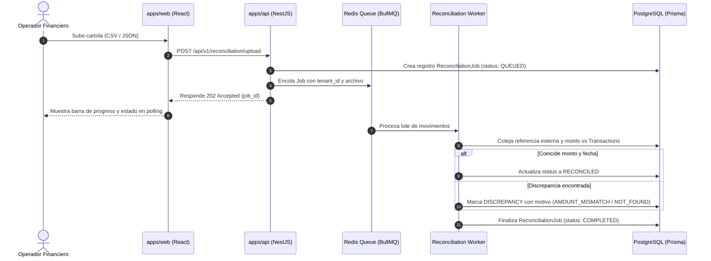

# LedgerFlow ⚡

> **Full-stack Payment Reconciliation & Automated Billing Engine built with NestJS, TypeScript, PostgreSQL, and React.**

[](https://github.com/diego/LedgerFlow/actions)
[](https://opensource.org/licenses/MIT)
[](https://nodejs.org/)
[](https://pnpm.io/)

---

## 📌 Contexto de Negocio & Problema

**LedgerFlow** es una plataforma SaaS B2B multi-tenant diseñada para resolver la fricción operativa y financiera entre pasarelas de pago (Transbank, Stripe, Mercado Pago), cobros transaccionales masivos y emisión de facturación electrónica.

### ¿Qué problemas resuelve?
1. **Descalce de Cartolas Bancarias vs Pasarelas:** Las empresas procesan miles de cobros diarios que no siempre coinciden exactamente con los depósitos bancarios debido a comisiones ocultas, desfases de liquidación (T+1 / T+2) o rechazos tardíos.
2. **Inconsistencias Contables y Registros Huérfanos:** Fallos en la red o desconexiones pueden generar transacciones aprobadas sin factura o saldos de clientes desactualizados sin garantías transaccionales ACID.
3. **Fugas de Datos entre Organizaciones:** Requerimiento imperativo de segregación estricta de datos (*Multi-Tenancy*) a nivel de base de datos y transporte HTTP mediante RBAC.

---

## 🏛️ Arquitectura del Sistema

### Monorepo Workspaces (`pnpm`)



### Flujo de Conciliación en Segundo Plano (Worker BullMQ + Redis)



---

## 🗄️ Modelo Relacional de Datos (PostgreSQL)


---

## 🚀 Inicio Rápido en Local

### Prerrequisitos
* **Node.js**: `>= 20.x` (probado en Node 22+)
* **pnpm**: `>= 9.x`
* **Docker & Docker Compose**

### 1. Clonar el repositorio y configurar variables de entorno

```bash
git clone https://github.com/diego/LedgerFlow.git
cd LedgerFlow
cp .env.example .env
```

### 2. Levantar la infraestructura (PostgreSQL 16 & Redis 7)

```bash
pnpm docker:up
```

Verificar que los contenedores estén saludables:
```bash
docker compose ps
```

### 3. Instalar dependencias e inicializar Prisma

```bash
pnpm install
pnpm db:generate
```

### 4. Ejecutar la base de datos y migraciones iniciales

```bash
pnpm db:migrate
pnpm db:seed
```

### 5. Iniciar los entornos de desarrollo

* Iniciar tanto la API como la interfaz web en paralelo:
```bash
pnpm dev
```

* O individualmente:
```bash
pnpm dev:api    # NestJS API en http://localhost:4000
pnpm dev:web    # React Vite en http://localhost:5173
```

---

## 📖 Documentación Interactiva de la API

Con la API en ejecución, accede a la documentación OpenAPI/Swagger en:
👉 **[http://localhost:4000/api/docs](http://localhost:4000/api/docs)**

Permite explorar los esquemas DTO, probar autenticación con JWT Bearer y validar las respuestas HTTP en tiempo real.

---

## 🛡️ Seguridad y Buenas Prácticas

* **Cero `any`:** Validación de tipos estricta en TypeScript de extremo a extremo.
* **Transaccionalidad ACID:** Operaciones de cobro y emisión de factura encapsuladas en `prisma.$transaction`.
* **Multi-Tenancy Garantizado:** Decoradores `@TenantId()` y filtros obligatorios por `tenant_id` en cada consulta relacional.
* **Spec-Driven Development:** Contratos Swagger generados automáticamente para sincronización con el frontend.
