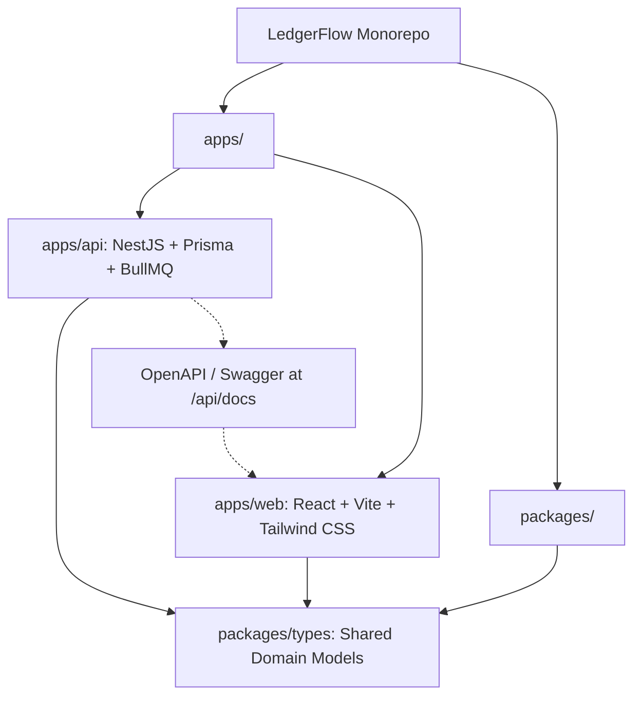
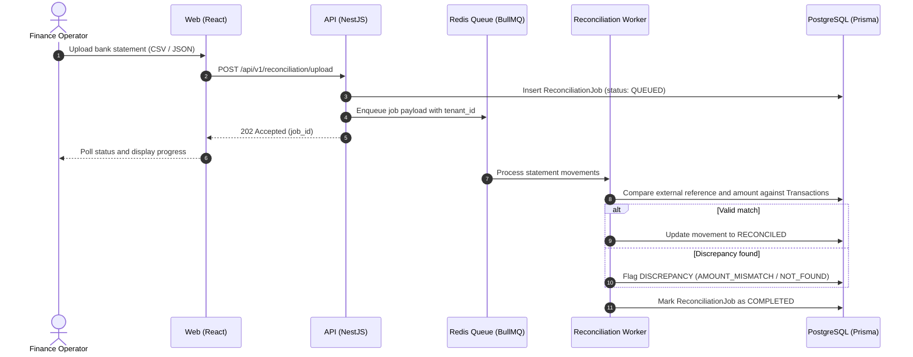
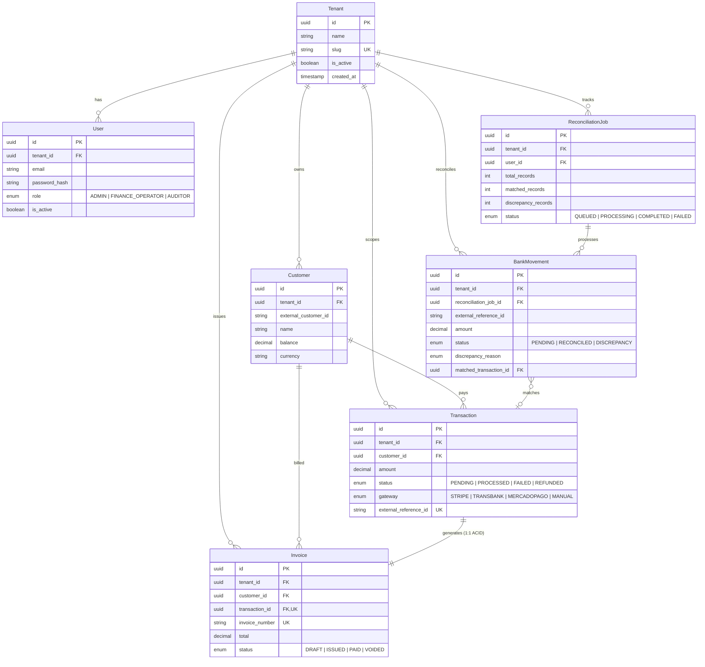

# LedgerFlow

Multi-tenant payment reconciliation and automated billing platform built with NestJS, React, PostgreSQL, and Redis.

[](https://github.com/diego/LedgerFlow/actions)
[](https://opensource.org/licenses/MIT)
[](https://nodejs.org/)
[](https://pnpm.io/)

---

## Overview

LedgerFlow processes transactional payments, reconciles bank statements against gateway transactions, and issues billing records with strict tenant isolation and ACID guarantees.

### Key Capabilities

- **Automated Reconciliation**: Asynchronous batch processing of bank statements via BullMQ queues and Redis.
- **ACID Invoicing**: Atomic transaction and invoice generation via Prisma transactions.
- **Multi-Tenancy**: Data segregation by `tenant_id` across database queries, HTTP guards, and authentication tokens.
- **Role-Based Access Control (RBAC)**: Role validation (`ADMIN`, `FINANCE_OPERATOR`, `AUDITOR`) via JWT strategies and decorators.

---

## System Architecture

### Workspace Structure

The project is structured as a `pnpm` monorepo:

| Path | Description | Tech Stack |
|---|---|---|
| `apps/api` | Backend API and background workers | NestJS, Prisma ORM, BullMQ, Passport JWT, Swagger |
| `apps/web` | Frontend management dashboard | React 19, Vite, Tailwind CSS, TanStack Query/Table, Zustand |
| `packages/types` | Shared contracts, DTO interfaces, and enums | TypeScript, tsup |



### Reconciliation Workflow



---

## Data Model



---

## Getting Started

### Prerequisites

- **Node.js**: `>= 20.x`
- **pnpm**: `>= 9.x`
- **Docker** and **Docker Compose**

### Installation and Setup

1. **Clone the repository and configure environment variables:**
   ```bash
   git clone https://github.com/diego/LedgerFlow.git
   cd LedgerFlow
   cp .env.example .env
   ```

2. **Start infrastructure services (PostgreSQL 16 & Redis 7):**
   ```bash
   pnpm docker:up
   ```

3. **Install dependencies and generate Prisma client:**
   ```bash
   pnpm install
   pnpm db:generate
   ```

4. **Run database migrations and initial seed:**
   ```bash
   pnpm db:migrate
   pnpm db:seed
   ```

5. **Start development servers:**
   ```bash
   pnpm dev
   ```

   Individual services can also be run separately:
   - Backend API (`http://localhost:4000`): `pnpm dev:api`
   - Frontend application (`http://localhost:5173`): `pnpm dev:web`

---

## API Documentation

When the API server is running, the interactive OpenAPI/Swagger interface is accessible at:

**[http://localhost:4000/api/docs](http://localhost:4000/api/docs)**

---

## Available Scripts

| Command | Description |
|---|---|
| `pnpm dev` | Starts all applications in parallel |
| `pnpm dev:api` | Starts the NestJS API in watch mode |
| `pnpm dev:web` | Starts the Vite development server |
| `pnpm build` | Builds all packages and applications |
| `pnpm test` | Runs test suites across the monorepo |
| `pnpm docker:up` | Starts PostgreSQL and Redis containers |
| `pnpm docker:down` | Stops infrastructure containers |
| `pnpm db:migrate` | Applies Prisma migrations |
| `pnpm db:generate` | Generates Prisma client types |
| `pnpm db:seed` | Seeds database with initial tenant and transaction data |
| `pnpm db:studio` | Launches Prisma Studio web interface |

---

## License

This project is licensed under the [MIT License](LICENSE).
